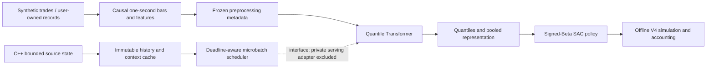

# Transformer–SAC: causal models and streaming inference

Research on connecting a causal quantile Transformer to an inventory-aware Soft Actor-Critic policy, with explicit numerical, temporal and resource contracts for streaming inference.

This selected research core contains the project's Python models and simulation, plus C++ state, queue and microbatch scheduling components. It runs synthetic CPU checks without a feed account, market-data download or trained weights. The operational trading system and its Git history remain private. This candidate has no live launcher, vendor SDK, broker connection or order-submission path.

## Research question

How can a forecast-to-policy interface preserve causal inputs, consistent accounting and bounded inference work when symbols have uneven activity and different history lengths? The project treats predictive quality, simulated economic outcomes and serving correctness as separate questions. This repository supports inspection and synthetic validation of the design; it does not establish investment returns or learned-model generalization.

## Architecture



The custom Transformer implementation combines RoPE, causal attention, learned relative-position and local return-delta biases, regime embeddings, quantile heads and weighted pinball loss. The small CPU example exercises the same model class with random weights. Larger private research configurations and learned artifacts are not distributed.

The SAC implementation uses SimBa-style residual networks, interacting twin critics, entropy-temperature tuning and an inventory-dependent signed-Beta action mapping. Its original V4 environment separates horizon rewards from cash-plus-inventory equity and preserves pending-first real-bar execution semantics. These are research simulation rules, not observed broker fills.

The native code demonstrates bounded queues, immutable history ownership, context reuse, source-generation checks, completion handling and deadline gating. Neural-network execution in the private runtime uses Python/PyTorch CUDA. This repository does not claim custom CUDA kernels or a C++ neural-network implementation. The native mock worker tests scheduling without a GPU or model checkpoint.

## What was contributed

The owner confirms responsibility for the Transformer/SAC research design and integration, Python research development, accounting/interface decisions, and the direction and validation of native C++/PyTorch CUDA integration. Native implementation and debugging were AI-assisted. SAC, RoPE and SimBa are established methods and are credited below; the contribution is the custom design, integration and evidence-driven engineering. See [contributions](docs/contributions.md).

## Run the research checks

Tested platform: Linux x86-64, CPython 3.11.18, CPU-only PyTorch 2.15.0, NumPy 2.2.6 and pandas 2.3.3. Install the exact hash-locked environment; no CUDA packages, data or models are needed:

```bash
python3.11 -m venv /tmp/transformer-sac-research
/tmp/transformer-sac-research/bin/python -m pip install --require-hashes --only-binary=:all: -r requirements/linux-cpu-py311.lock
/tmp/transformer-sac-research/bin/python -m pip install --no-deps --no-build-isolation .
CUDA_VISIBLE_DEVICES='' OMP_NUM_THREADS=1 OPENBLAS_NUM_THREADS=1 /tmp/transformer-sac-research/bin/python -m pytest -q -p no:cacheprovider
CUDA_VISIBLE_DEVICES='' OMP_NUM_THREADS=1 /tmp/transformer-sac-research/bin/python examples/synthetic_cpu.py
```

The retained algorithm/accounting controls and new regression tests cover causality, invalid model bindings, nonfinite output rejection, stable ordering of equal-timestamp trades, signed action mapping, recovery and numerical controls. Native tests additionally exercise allocation, queue, cache, deadline and drain invariants. Build the optional native numeric probe for the complete Python suite; without it one test is explicitly skipped. [Reproducibility](docs/reproducibility.md) documents commands, external OpenSSL/oneMKL requirements and exact scope; [validation results](docs/validation.md) distinguish synthetic checks from absent trained-model reproduction.

## Repository map

```text
src/streaming_research/
  features/       causal aggregation, feature math and frozen scaling
  forecasting/    custom Transformer, losses, target/output definitions
  policy/         original SAC, V4 simulation and equity accounting
  runtime/        recovery guard, in-memory model binding and buffered inference
native/
  include/        bounded state, queue, cache, scheduler and reference types
  src/           numerical recurrence and admission integrity
  tests/         synthetic invariants and mock-worker scheduling
tests/           Python accounting, recovery, causality and regression controls
examples/        synthetic inputs and random-weight CPU execution
requirements/    audited CPU wheel hashes, including build tools
docs/            architecture, numerical contract, validation and provenance
```

Validated algorithms were retained rather than replaced with simplified models. Three candidate boundary fixes are documented: reject nonfinite output before valid flags, preserve input order for timestamp ties, and reject unsupported non-one-second aggregation. Unused profiling duplicates and scanner/file-export code were removed. [Source map](docs/source_map.json) records original hashes and explicit deviations. Small offline ledger/reference types remain as native dependency closure; no broker/PAPER service is included.

## Limits and release boundary

This repository does not reproduce the private trained checkpoint, fitted preprocessing or licensed-feed CUDA session. Complete historical-to-native learned-model parity, untouched historical holdout provenance, profitable live trading, autonomous deployment and general capacity claims remain unestablished. Synthetic agreement does not prove arbitrary precision, batch-size, hardware or economic equivalence.

The source-only candidate excludes recordings, prices, real feature tables, symbol-level results, private benchmark receipts, fitted assets, credentials and vendor headers/libraries. Verified private operational measurements remain separate in the ETH review package, pending any needed disclosure permissions. No market-data redistribution right is assumed. See [release boundary](docs/release_boundary.md), [limitations](docs/limitations.md), [license status](LICENSE_STATUS.md) and [third-party notices](THIRD_PARTY_NOTICES.md).

References: [Soft Actor-Critic](https://arxiv.org/abs/1801.01290), [RoFormer/RoPE](https://arxiv.org/abs/2104.09864), [SimBa](https://arxiv.org/abs/2410.09754).
