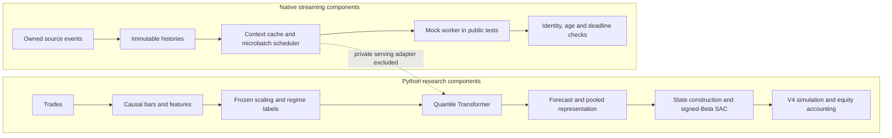

# Transformer–SAC: learning, numerics and streaming inference

This project originated in intraday financial-market research: learning from trade streams to forecast short-horizon price excursions and study inventory-aware decisions with reinforcement learning. Developing the pipeline turned the application into a scientific computing problem involving causal forecasting, numerical consistency and real-time inference.

The research question is how to preserve the meaning of observations, model outputs and state across a forecast-to-policy pipeline, while inference work competes for finite time and memory.

## Research motivation

A forecast must use only observations available at its input time. A policy's requested action must be interpreted against current inventory and pending orders, while a delayed result may no longer describe the current state. Floating-point precision, reduction order and data layout can introduce further differences between implementations.

This project makes those contracts explicit:

- **Temporal modeling:** construct causal features and multi-horizon quantile targets, then preserve feature/target identity through inference.
- **Sequential decisions:** distinguish a policy's signed latent, its inventory-constrained action and the simulator's actual fills and equity.
- **Numerical and systems validation:** compare qualified computations, enforce bounded ownership and work queues, and reject stale or nonfinite results.

## Project contributions

| Area | Implemented work |
|---|---|
| Python research and model design | Causal aggregation/features; a configurable RoPE quantile Transformer with regime, relative-position and return-delta inputs; forecast-to-policy interfaces. |
| Policy and simulation | Signed-Beta SAC research stack, explicit state/action interaction features, replay/update code and the original V4 pending-order/cash/inventory accounting. |
| Numerical methods | Streaming feature recurrences, explicit precision/reduction choices and synthetic Python/native comparison controls. |
| Native streaming integration | Bounded source queues, immutable histories, context reuse, source identity and deadline-aware microbatch scheduling, with a synthetic mock worker. |

The contribution is the project's custom design, Python development, integration and validation of these components. SAC, RoPE and SimBa are established methods, credited below. Neural-network CUDA execution uses PyTorch.

## Architecture



The diagram maps component interfaces. The public example exercises the Python feature/Transformer path; SAC and native scheduling have separate focused tests. The operational adapter that connects a licensed feed to trained CUDA models is outside this repository.

## Models and numerical methods

### Quantile Transformer

[The implementation](src/streaming_research/forecasting/transformer.py) combines causal RoPE attention, optional learned relative-position and local return-delta biases, and learned embeddings for two regime-label streams. Quantile heads predict configured future log-price excursion targets; inference also exposes a pooled hidden representation, with a mean-of-last-16 mode.

Training utilities retain weighted pinball loss,

$$\rho_\tau(e)=\max\{\tau e,(\tau-1)e\},\qquad e=y-\hat q_\tau,$$

with sample weighting and optional target weighting. Target definitions, quantile order and frozen preprocessing metadata are part of the model interface. The small example instantiates this same model class with random weights. Optional CPC heads are present but disabled in the example; no trained forecasting accuracy is claimed here.

### SAC and stateful simulation

[The policy implementation](src/streaming_research/policy/sac.py) uses SimBa-style residual networks and twin Q-networks. Each critic combines separately encoded state/action features, their product and their difference. A Beta-distributed variable is mapped to a signed latent; positive values scale remaining buy capacity and negative values scale current inventory. Zero latent requests no trade.

Replay structures, multi-step returns, target-network updates and automatic temperature tuning are retained. The historical entropy formulation has numerical limitations documented in the [signed-Beta log-density analysis](docs/numerical_contract.md#signed-beta-log-density-known-issue).

The [V4 environment](src/streaming_research/policy/v4_environment.py) and [accounting functions](src/streaming_research/policy/accounting.py) distinguish requested actions, pending orders, fills, costs and cash-plus-marked-inventory equity. Overlapping reward-horizon sums are a different quantity from equity P&L.

### Native numerical and streaming components

The C++ feature path uses float64 recurrence state and float32 model inputs. Reduction order, explicit FMA, frozen transforms, compiler flags and the selected BLAS runtime are treated as reproducibility choices. The NumPy-derived log/reduction design retains its BSD attribution; the native log probe is checked on 4,096 synthetic values at absolute tolerance `2e-6`.

Source ownership, immutable history, context-cache identity, bounded queues and deadline gating are explicit in the native headers. These components are tested with generated events and a mock worker. This is C++ numerical/state/scheduling infrastructure around a model interface, not C++ neural-network execution or custom CUDA kernels. [Architecture](docs/architecture.md) and [numerical contract](docs/numerical_contract.md) describe the boundaries.

## Validation evidence

The recorded Linux/CPython 3.11 CPU profile passed:

| Control | Recorded evidence |
|---|---|
| Python tests | **72 tests + 45 subtests**: causality, accounting, recovery, model binding, action mapping, inference agreement and regression controls. |
| Native suites | **4/4**: core/history, bounded allocation, queue behavior and context scheduling/drain. |
| Numerical comparison | 4,096 synthetic positive inputs; native log versus NumPy within `2e-6` absolute tolerance. |
| Synthetic example | 240 generated bars; 37 finite output fields from a small random-weight model. |
| Environment | Hash-locked CPU wheels, installed-package checks and dependency consistency; no model/data downloads in the checks. |

These are component controls, not trained-model, throughput or profitability benchmarks. The controls do not certify probabilistic calibration. Three inherited Torch SDPA deprecation warnings remain. [Validation scope](docs/validation.md) and [machine-readable results](docs/validation_results.json) record what was exercised.

## Reproduce the CPU checks

Tested: Linux x86-64, CPython 3.11.18, PyTorch 2.15.0+cpu, NumPy 2.2.6 and pandas 2.3.3. From the repository root:

```bash
python3.11 -m venv /tmp/transformer-sac-research
/tmp/transformer-sac-research/bin/python -m pip install --require-hashes --only-binary=:all: -r requirements/linux-cpu-py311.lock
/tmp/transformer-sac-research/bin/python -m pip install --no-deps --no-build-isolation .
CUDA_VISIBLE_DEVICES='' OMP_NUM_THREADS=1 OPENBLAS_NUM_THREADS=1 /tmp/transformer-sac-research/bin/python -m pytest -q -p no:cacheprovider
CUDA_VISIBLE_DEVICES='' OMP_NUM_THREADS=1 /tmp/transformer-sac-research/bin/python examples/synthetic_cpu.py
```

Without the optional native probe, one Python test is explicitly skipped. Native builds need C++20, CMake, OpenSSL development files, oneMKL and local UNIX-socket permission. [Reproducibility instructions](docs/reproducibility.md) provide the native commands, dependency qualification and installed-wheel check details.

## Navigate the implementation

| Path | Responsibility |
|---|---|
| [`features/`](src/streaming_research/features/) | Causal aggregation, feature math and frozen scaling. |
| [`forecasting/`](src/streaming_research/forecasting/) | Transformer, target/loss definitions and output pooling. |
| [`policy/`](src/streaming_research/policy/) | SAC, V4 environment and execution/equity accounting. |
| [`runtime/`](src/streaming_research/runtime/) | Recovery, validated in-memory model binding and buffered inference. |
| [`native/`](native/) | Bounded state, queue/cache/scheduler, numerical kernels and synthetic tests. |
| [`tests/`](tests/), [`examples/`](examples/) | Python controls and the synthetic CPU example. |

[Source provenance](docs/source_map.json) records the original extraction and explicit boundary fixes; [the manifest](PUBLICATION_MANIFEST.csv) binds every included file.

## Scope and limitations

The public repository contains research components and synthetic controls. It does not include a trained checkpoint, fitted transforms, training CLI or the private feed-to-CUDA runtime. Complete historical-to-native learned-model parity and immutable historical holdout provenance remain incomplete. Quantile calibration, learned-policy quality, live profitability, broker fills, autonomous deployment and general capacity are not established by these checks.

Licensed data, private quantitative results, recordings, vendor SDK payloads, fitted assets and credentials remain excluded. External native dependencies have their own security/license qualification; one tested profile does not validate arbitrary hardware, precision, batch sizes or later package versions. See the [release boundary](docs/release_boundary.md).

## License and references

Project-owned source is published under [MIT](LICENSE). The [NumPy BSD notice](licenses/NUMPY-BSD-3-Clause.txt) and [third-party notices](THIRD_PARTY_NOTICES.md) retain the separate attribution and dependency boundaries.

- [Soft Actor-Critic](https://arxiv.org/abs/1801.01290)
- [RoFormer / rotary position embeddings](https://arxiv.org/abs/2104.09864)
- [SimBa](https://arxiv.org/abs/2410.09754)
