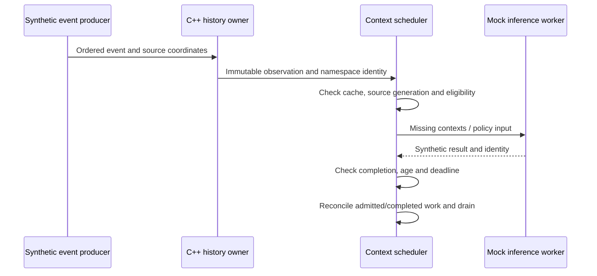

# Architecture and module authority

The feature-to-policy path and the native scheduler are separable research components. The synthetic Python example connects the feature/model interfaces; native tests exercise the scheduler with a mock worker. The private operational adapter connecting a licensed feed to trained CUDA models is deliberately excluded. There is no public end-to-end live service.

`features.trades` accepts user-owned records, builds one-second bars and retains causal time/flow/return features and frozen-scaler arithmetic. Equal-timestamp records retain caller order; multi-second cadence is rejected because the original one-second routine otherwise silently discarded off-grid trades. Downloading, global fitting and historical broken wrapper/cache paths are excluded.

`forecasting.transformer` retains HFTQuantileCPCTransformer, causal/RoPE attention, relative-position and return-delta biases, quantile targets and weighted pinball loss. CPC is an optional existing research mechanism, not a claimed invention. The excluded context-model variant is not supported by this extraction.

`policy.sac` retains original policy/critic networks, replay structures and SAC update. `policy.v4_environment` and `policy.accounting` retain the original state, pending-target, cost and cash/inventory rules. Overlapping horizon rewards are not equity P&L. No replacement fill model was introduced.

`runtime.transformer_runner` and `runtime.transformer_fast` bind a caller-owned in-memory model and frozen metadata. They validate dimensions/labels, freeze parameters and preserve original array preparation, pooling and buffered inference. Nonfinite forecasts/embeddings now raise before valid flags are produced. Shape checks cannot establish the semantic truth of caller-supplied feature/target order. No checkpoint deserializer is included.

The native closure contains bounded source ownership, immutable histories, context cache, FIFO/microbatch scheduling, tensor ABI and reference semantics. `slot_limits.hpp` retains an allocation bound only; the private scanner strategy/thresholds and unused file exporter are omitted. `paper.hpp`/`execution.hpp` provide offline reference types consumed by retained code, with no broker/PAPER service. The project-authored abstract Sdk interface is not a vendor implementation; native tests require no Nanex header/library.

Actual CUDA batching, precision, upstream source timing and trained outputs remain private evidence. No measured speedup is claimed for this extracted tree.
